

  

  

  

  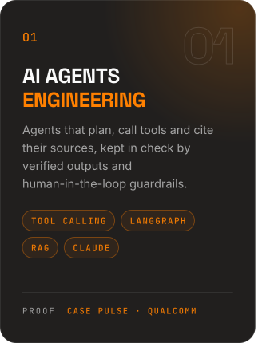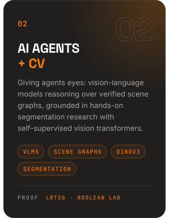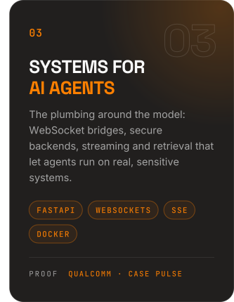

  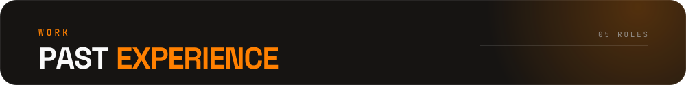

  

  

  <a href="https://github.com/Ashindustry007/DataHacks26-Allerion">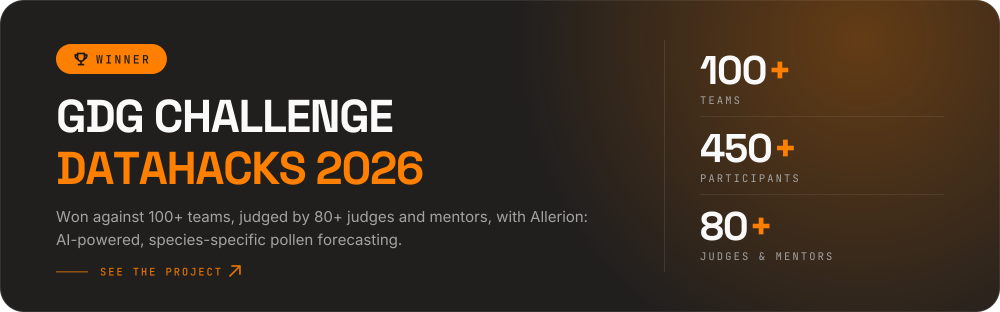</a>

  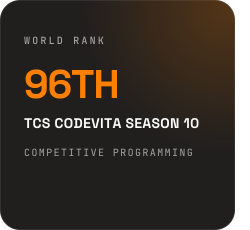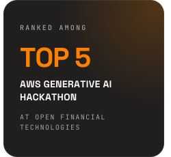<a href="https://doi.org/10.1109/ICECA52323.2021.9675980">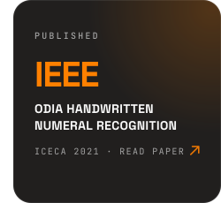</a>

  

  <a href="https://github.com/Ashindustry007/Case-Pulse">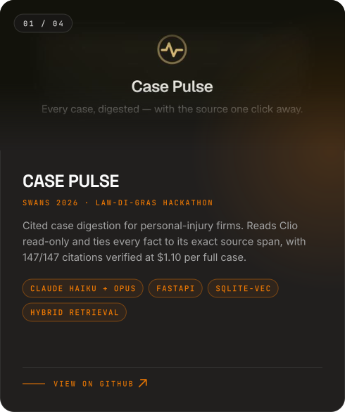</a><a href="https://github.com/Ashindustry007/DataHacks26-Allerion">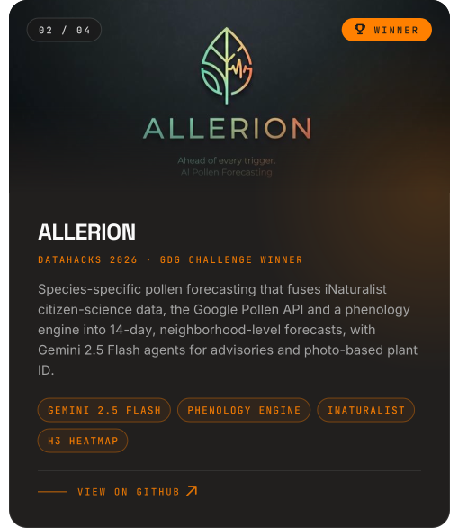</a>

  <a href="https://github.com/Ashindustry007/LRTSG---Language-Reasoning-Task-with-Scene-Graph">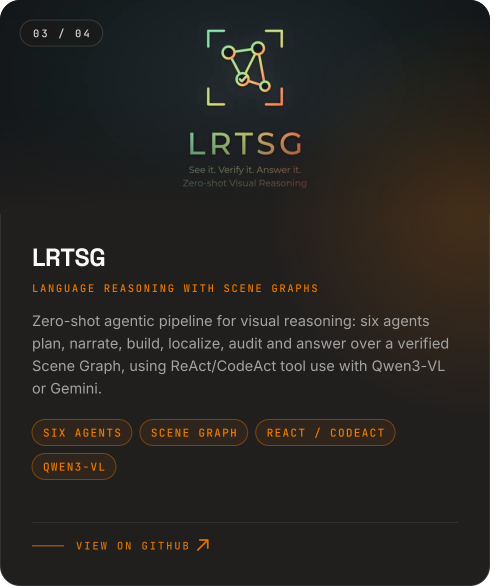</a><a href="https://github.com/Ashindustry007/SAFE">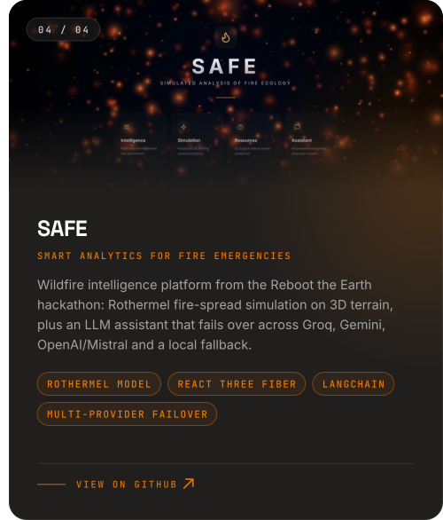</a>

  <a href="https://github.com/Ashindustry007/MusicNet">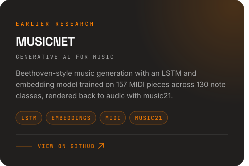</a><a href="https://github.com/Ashindustry007/Retina_Image_Segmentation">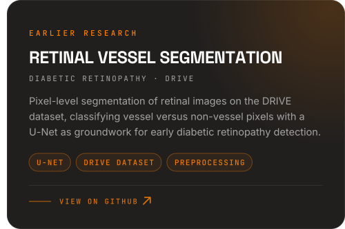</a>

  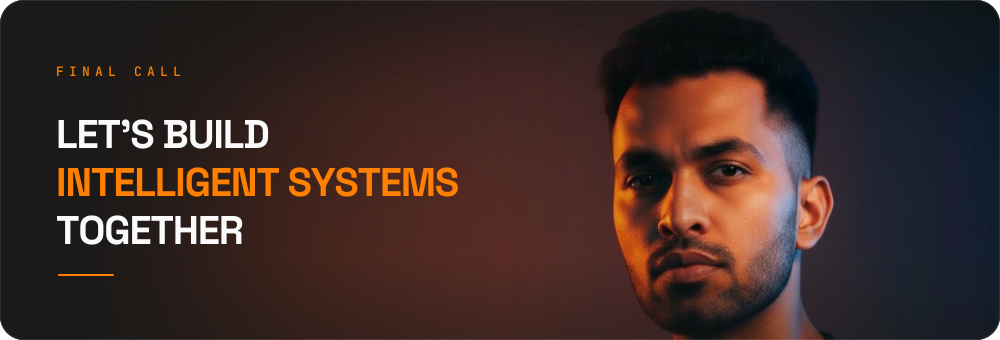

  
  
  
  

